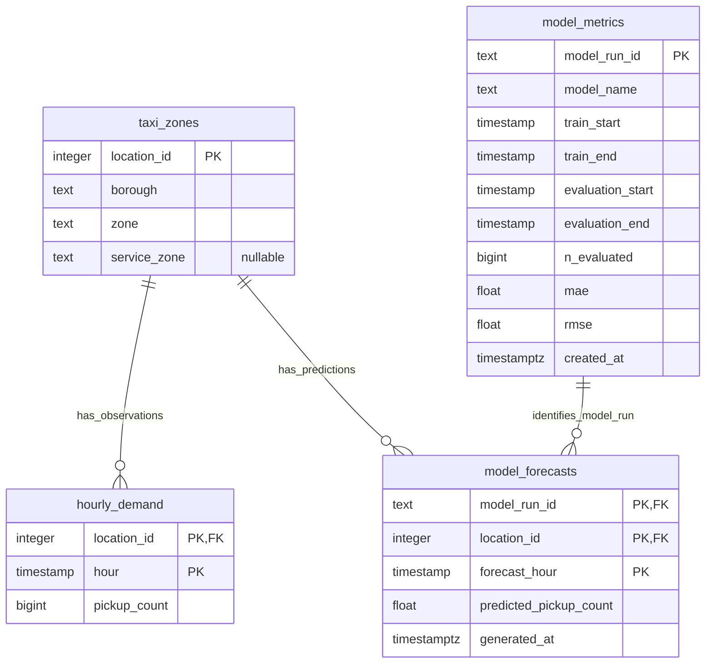

# Taxi database relationships

Each demand row represents one zone and one observed pickup hour. Zone names and
boroughs live in the lookup table rather than being repeated in every observation.
The composite primary key is `(location_id, hour)`.

Each metrics row describes one model run and one chronological evaluation window.
Insert that row before its forecasts. A new fitted/evaluated run needs a new
`model_run_id`, even if the model algorithm is unchanged. Forecasts use the
composite key `(model_run_id, location_id, forecast_hour)`, allowing multiple
models to predict the same zone-hour without overwriting each other.

There is deliberately no foreign key from forecasts to demand: future actuals
may not exist. For evaluation, join them on zone and target hour, retaining
`model_run_id` so different runs stay separate. Forecast creation timestamps are
audit metadata, not a substitute for the historical information cutoff.

All pickup, forecast and evaluation-window timestamps preserve NYC local,
timezone-naive values from the current pipeline. Audit timestamps use
`TIMESTAMPTZ`. See the database README for missing-hour and DST limitations.
